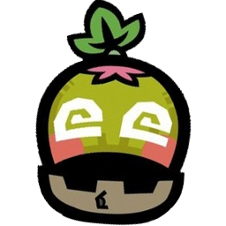

<p align="center">
  
</p>

<h1 align="center">Cha-Cha</h1>

<p align="center">
  <b>Monster Hunter 3 Ultimate, running natively on PC.</b><br>
  A static recompilation of the Wii U game for Windows and Linux.
</p>

<p align="center">
  <a href="../../releases/latest"></a>
  
  
  <a href="LICENSE"></a>
</p>

<p align="center">
  <a href="#getting-started">Getting started</a> ·
  <a href="#whats-new-compared-to-the-original">What's new</a> ·
  <a href="#dlc-event-and-challenge-quests">DLC quests</a> ·
  <a href="#texture-packs-and-texture-dumping">Texture packs</a> ·
  <a href="#whats-next">What's next</a> ·
  <a href="#building-from-source">Building</a>
</p>

---

Cha-Cha translates the game's PowerPC code into C++ ahead of time and compiles it for your PC. It runs on our own
reimplementation of the Wii U system libraries it uses, with graphics on Vulkan and input and audio on SDL3. It is
not an emulator, and there is no emulator code in it.

> [!IMPORTANT]
> **No game files are included.** You need your own copy of **Monster Hunter 3 Ultimate (US) with update v32**.
> Cha-Cha is a fan project, not affiliated with or endorsed by Capcom or Nintendo.

## What's new compared to the original

These are part of the game and always on.

<table>
  <tr>
    <td width="33%" valign="top">
      <h3>Item Sets</h3>
      Loadouts as in MH Generations Ultimate, inside the game's own item box menu (the house box and the small
      boxes such as the Port Tanzia dock).
      <ul>
        <li><b>Register Item Set</b> saves your pouch, <b>Load Item Set</b> refills it.</li>
        <li>5 sets each for Blademaster and Gunner.</li>
        <li>Loading takes only what your pouch and box really hold, and tells you what was missing.</li>
        <li>The game's pouch window previews the result while you choose; left / right turn its pages.</li>
      </ul>
    </td>
    <td width="33%" valign="top">
      <h3>Monster HP scaling</h3>
      Port Tanzia quests are balanced for four hunters. Hunting there with fewer, monsters now have:
      <table>
        <tr><th>Hunters</th><th>HP</th></tr>
        <tr><td>1</td><td>65%</td></tr>
        <tr><td>2</td><td>80%</td></tr>
        <tr><td>3</td><td>90%</td></tr>
        <tr><td>4</td><td>100%</td></tr>
      </table>
      At every rank: Low, High and G. Moga Village quests are unchanged.
    </td>
    <td width="33%" valign="top">
      <h3>Hold to gather</h3>
      Hold the gather button on a carcass, a gathering spot or a mining point and you keep going until the spot is
      used up. No more tapping through every carve.
      <h3>DLC quests again</h3>
      The event and challenge quests, once free downloads from a server that is long gone, install from files.
      <a href="#dlc-event-and-challenge-quests">See below.</a>
    </td>
  </tr>
</table>

### Made for PC

- **Your resolution and frame rate:** internal resolution from 0.5× to 4× (up to 5120×2880), a frame rate limit up
  to unlimited, V-sync, windowed / borderless / fullscreen.
- **Tri look:** the softer, muted, hazier picture of Monster Hunter Tri on the Wii, applied to the world only (menus
  and the HUD stay as they are).
- **Effects the original never had:** global illumination, ambient occlusion, an enhanced depth of field and a
  vignette, each optional. The game's own bloom and depth of field can be switched off.
- **Texture packs** and texture dumping for making them.
- **A real launcher:** PLAY / SETTINGS / MODS / QUIT over the game's own title screen. **F1** opens the settings
  over the game, **F2** the mods, **F3** cycles the GamePad screen (hidden, picture-in-picture, GamePad only).
- **Controls your way:** keyboard and mouse, or any controller SDL supports, played as a Wii U Pro Controller.
  Every button can be rebound, and the settings show which button does what, for your bindings and your
  controller (Xbox, PlayStation or Nintendo names).
- **A PC keyboard** for names and chat instead of the Wii U software keyboard.

## Getting started

| | Windows | Linux |
|---|---|---|
| **Download** | `Cha-Cha-<version>-windows-x64.zip` from [Releases](../../releases/latest) | `Cha-Cha-<version>-x86_64.AppImage` from [Releases](../../releases/latest) |
| **Needs** | Windows 10 / 11 x64 | x86-64 with glibc 2.35 or newer (Ubuntu 22.04, Fedora 36, Steam Deck…) |
| **Graphics** | a Vulkan 1.3 driver | a Vulkan 1.3 driver (Mesa or your GPU vendor's) |
| **Run** | extract the zip anywhere you can write to, run `Cha-Cha.exe` | `chmod +x Cha-Cha-*.AppImage`, then run it |

1. **Start Cha-Cha.** On the first start a setup screen asks for your game.
2. **Point it at your dump:** a `.wua` archive, or the game and update folders (`code`, `content`, `meta`). Cha-Cha
   checks that it is the US v32 executable and reads the files where they are; nothing is copied.
3. **Wait a few seconds** while the game's shaders are translated for your PC. This happens once.

Your **data folder** keeps settings, saves, caches, quests and texture packs:

| | Data folder |
|---|---|
| Windows | `%APPDATA%\Cha-Cha` |
| Linux | `~/.local/share/Cha-Cha` (or `$XDG_DATA_HOME/Cha-Cha`) |
| Portable | `data/` next to the program, when a file named `portable.txt` sits beside it (the Windows zip ships with one) |

Saves live in `<data folder>/save`. To skip the setup screen, start it with `--install <path to your dump>`.

### Default controls

| Wii U Pro Controller | Keyboard and mouse | Controller |
|---|---|---|
| Left stick / right stick | WASD / IJKL (or the mouse: click in the window, Esc releases) | sticks |
| A / B / X / Y | F, Return or right click / Space or Backspace / left click / E | the face buttons by position, as on the Wii U |
| L / R / ZL / ZR | Q / Left Shift / Z or mouse 4 / C or mouse 5 | LB / RB / LT / RT |
| + / − | Tab / M | Back / Start |
| D-pad | arrow keys, mouse wheel | d-pad |

Settings → Input switches the controller to the Xbox layout (A / Cross confirms) and rebinds anything. Bindings are
saved in `<data folder>/input.ini` ([docs/input.md](docs/input.md)).

## DLC: event and challenge quests

Capcom's download service for MH3U is gone. Cha-Cha installs the quests from files instead.

1. Open **MODS → Quests → Quest folder**. That is `<data folder>/quests`.
2. Put the quests in, each pack in a folder of its own:
   - **Official DLC:** the save files `quest1`, `quest2`, `quest3` and `quest4` from a Wii U save that has the
     downloaded quests, for example in `quests/DLC MH3U/`. Official packs install all their quests by themselves.
   - **Custom quests:** `q_<number>.quest` files, with an optional `pack.json`, `cover.png`, and a picture and
     description per quest. Custom packs let you pick quests one by one.
3. The quests appear at the **Port Tanzia Gathering Hall** with the event and challenge quests.

Pack format and options: [docs/mods.md](docs/mods.md). Quest files are game data, so Cha-Cha ships none.

## Texture packs and texture dumping

**Using a pack:** put the DDS files in `<data folder>/texture_replacements` (subfolders are fine) and turn on
Settings → Video → **Texture packs**. It switches on and off while you play.

**Making a pack:**

1. Turn on Settings → Video → **Dump textures**. Every texture the game draws from then on is saved to
   `<data folder>/texture_dump` as a DDS file, already named for replacement: `tex_<width>x<height>_<CRC32>.dds`.
   A note in the corner shows the folder and how many have been saved. Dumping lasts until you quit.
2. Edit the ones you want. Keep the name (you may add text after the CRC), include mipmaps, and copy them into
   `texture_replacements`.

Packs made for the 3DS version don't match the Wii U textures and won't load. Details:
[docs/texture-packs.md](docs/texture-packs.md).

## What's next

- **Local network play:** hunt together with players on the same network.
- **Online play:** Cha-Cha's own lobby server in place of Nintendo's retired service
  ([docs/online.md](docs/online.md)), with HP scaling then using the real number of hunters.
- **Quest maker:** build your own quests and share them as packs for the MODS → Quests library.

## Building from source

The build translates **your own dump's** executable into C++, so put a dump in place first.

1. Put your dump at `game/mh3u.wua` ([game/README.md](game/README.md)), then run
   `powershell -File scripts/extract.ps1` and `powershell -File scripts/fingerprint.ps1`.
2. **Windows:** Visual Studio 2026 with "Desktop development with C++" and the Vulkan SDK
   ([tools/README.md](tools/README.md)):

   ```
   cmake -S . -B build/cmake
   cmake --build build/cmake --config Release
   ctest --test-dir build/cmake -C Release --output-on-failure
   ```

   A clang-cl build (`cmake -S . -B build/clang -T ClangCL`) compiles the generated code faster.
   `scripts/package-release.ps1` makes the release zip.
3. **Linux** (or WSL2 on Windows): clang 15+, Ninja, CMake 3.25+, the LunarG Vulkan SDK, `libvulkan-dev`,
   `libavcodec-dev` and SDL3's build dependencies. `scripts/build-linux.sh` builds it, `scripts/package-appimage.sh`
   makes the AppImage ([docs/linux.md](docs/linux.md)).

Inside the checkout Cha-Cha finds `extracted/` by itself and uses the checkout as its data folder (all of it
gitignored). The release packages never contain game files, but the program itself contains the recompiled game
code, translated from your executable at build time.

<details>
<summary><b>Repository layout</b></summary>

| Path | What lives there | In git? |
|---|---|---|
| `game/`, `extracted/` | Your dump, and its unpacked contents | no |
| `config/` | Target hashes, symbol map, function list, known structures | yes |
| `recomp/` | The recompiler; `recomp/out/` is the generated C++ | source only |
| `runtime/` | The PC layer replacing the Wii U system: `os`, `gfx` (GX2 on Vulkan), `audio`, `input`, `fs`, `boot` | yes |
| `src/` | Hand-written game code: item sets, hold to gather, HP scaling… | yes |
| `tools/`, `scripts/`, `ghidra/` | Shader translator, helper scripts, reverse-engineering scripts | yes |
| `docs/` | Roadmap, research log, formats, mods, input, Linux, online notes | yes |
| `build/` | Build output | no |

How the port works and what was learned: [docs/runtime.md](docs/runtime.md), [docs/engine.md](docs/engine.md),
[docs/research-log.md](docs/research-log.md).

</details>

## Credits

- **Dusklight**: the Twilight Princess PC port whose front end (launcher, title
  screen, settings window) Cha-Cha's front end follows.
- **Yakumo**: the asset-free release model Cha-Cha follows: a release build plus your own dump, nothing from the
  game shipped.
- **Ghidra**, for reverse engineering.
- **Libraries:** SDL3, Dear ImGui, zstd, the Vulkan SDK (shaderc, glslang, SPIRV-Tools), FFmpeg's libavcodec on
  Linux ([docs/release/THIRD_PARTY_NOTICES.md](docs/release/THIRD_PARTY_NOTICES.md)).

Monster Hunter is a trademark of Capcom. Wii U is a trademark of Nintendo.

## License

Cha-Cha is free software under the **GNU General Public License v3.0** ([LICENSE](LICENSE)): you may use, study,
change and share it, and if you share a changed version you share its source under the same licence. Third-party
libraries keep their own licences. The licence covers Cha-Cha's own code only, not the game: Monster Hunter 3
Ultimate and everything translated from it remain Capcom's.
