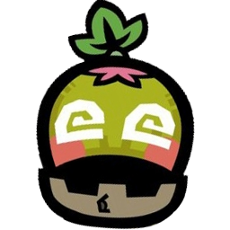
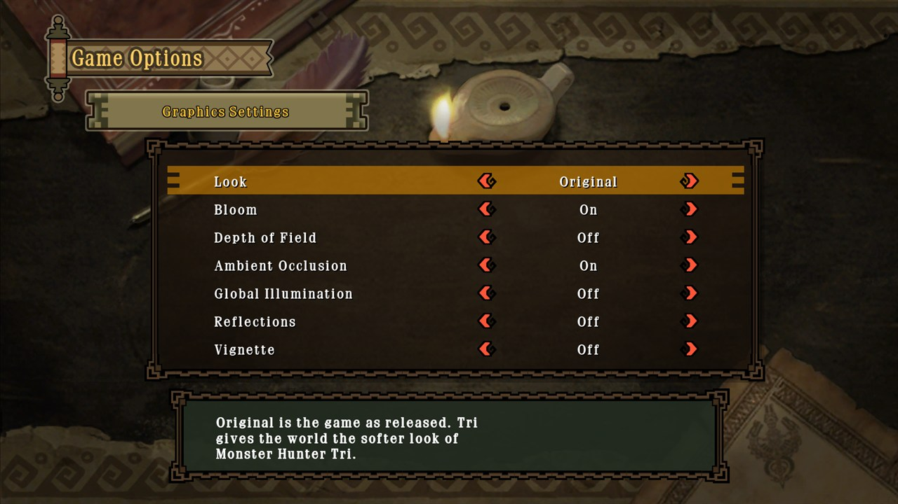
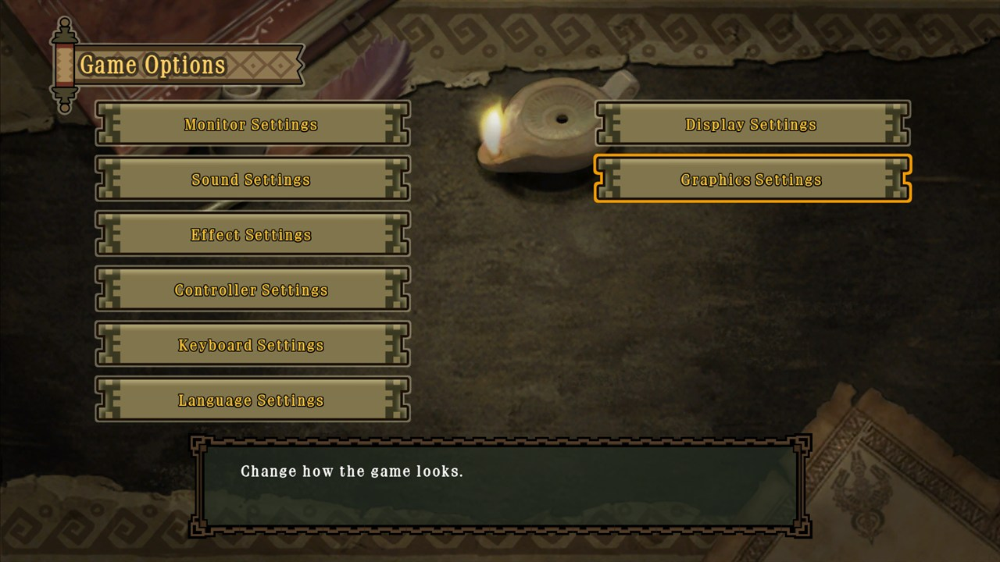
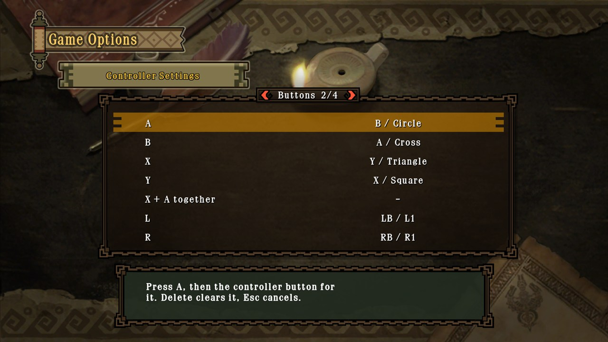
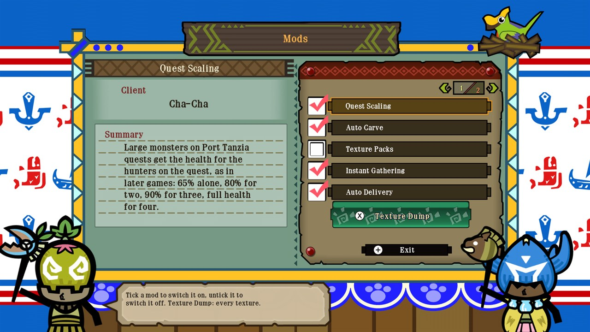

<p align="center">
  
</p>

<h1 align="center">Cha-Cha</h1>

<p align="center">
  <b>Monster Hunter 3 Ultimate, running natively on PC.</b><br>
  A static recompilation of the Wii U game for Windows and Linux, with an experimental Android build.
</p>

<p align="center">
  <a href="../../releases/latest"></a>
  
  
  <a href="LICENSE"></a>
</p>

<p align="center">
  <a href="#getting-started">Getting started</a> ·
  <a href="#whats-new-compared-to-the-original">What's new</a> ·
  <a href="#the-dlc-screen-quests-and-mods">DLC and mods</a> ·
  <a href="#texture-packs">Texture packs</a> ·
  <a href="#whats-next">What's next</a> ·
  <a href="#building-from-source">Building</a>
</p>

---

Cha-Cha translates the game's PowerPC code into C++ ahead of time and compiles it for your PC. It runs on our own
reimplementation of the Wii U system libraries it uses, with graphics on Vulkan and input and audio on SDL3. It is
not an emulator, and there is no emulator code in it.

> [!IMPORTANT]
> **No game files are included.** You need your own copy of **Monster Hunter 3 Ultimate (US) with update v32**.
> Cha-Cha is a fan project, not affiliated with or endorsed by Capcom or Nintendo.

<p align="center">
  
</p>

> [!TIP]
> **New in 0.2.0:** no launcher any more, every setting inside the game's own menus, the Modern Camera and Camera
> Distance, switchable gameplay mods, the DLC screen working again, and a first Android build.
> [Release notes](../../releases/tag/v0.2.0).

## What's new compared to the original

<table>
  <tr>
    <td width="33%" valign="top">
      <h3>Item Sets</h3>
      Loadouts as in MH Generations Ultimate, inside the game's own item box menu (the house box and the small
      boxes such as the Port Tanzia dock).
      <ul>
        <li><b>Register Item Set</b> saves your pouch, <b>Load Item Set</b> refills it.</li>
        <li>5 sets each for Blademaster and Gunner.</li>
        <li>Loading takes only what your pouch and box really hold, and tells you what was missing.</li>
        <li>The game's pouch window previews the result while you choose; left / right turn its pages.</li>
      </ul>
    </td>
    <td width="33%" valign="top">
      <h3>Monster HP scaling</h3>
      Port Tanzia quests are balanced for four hunters. With <b>Quest Scaling</b> on (the default), monsters there
      have:
      <table>
        <tr><th>Hunters</th><th>HP</th></tr>
        <tr><td>1</td><td>65%</td></tr>
        <tr><td>2</td><td>80%</td></tr>
        <tr><td>3</td><td>90%</td></tr>
        <tr><td>4</td><td>100%</td></tr>
      </table>
      At every rank: Low, High and G. Moga Village quests are unchanged.
    </td>
    <td width="33%" valign="top">
      <h3>A camera for PC</h3>
      The <b>Modern Camera</b> orbits freely on quests: the mouse moves it directly, the stick turns and tilts at
      once, and it drifts back behind you as you run. <b>Camera Distance</b> pulls it back up to 200 % so big
      monsters stay on screen.
      <h3>DLC quests again</h3>
      The event and challenge quests, once free downloads from a server that is long gone, come in through the game's
      own DLC screen. <a href="#the-dlc-screen-quests-and-mods">See below.</a>
    </td>
  </tr>
</table>

### Gameplay mods, each one a switch

| Mod | What it does | Default |
|---|---|---|
| **Quest Scaling** | Monster HP on Port Tanzia quests follows the number of hunters (table above). | On |
| **Auto Carve** | Hold the gather button on a carcass, a gathering spot or a mining point and you keep going until the spot is used up. | On |
| **Texture Packs** | Your replacement textures, [see below](#texture-packs). | On |
| **Instant Gathering** | One gather, mine or bug-net swing takes everything a spot has left; each item still rolls its reward and tool breakage. | Off |
| **Auto Delivery** | Delivery goals are handed in as soon as your pouch holds enough (eggs and other carried items still go to camp). | Off |
| **Key Quest Markers** | A star on key and urgent quests: gold while you still need them, grey once cleared. | Off |

Switch them in the main menu's **DLC → Mods** or in the pause menu's **CFG → Mods**, also on a quest.

### Made for PC

- **Settings inside the game, no launcher.** Game Options gains **Display Settings** and **Graphics Settings**,
  **Controller Settings** remaps your controller and **Keyboard Settings** your keys and mouse. The pause menu's new
  **CFG** tab holds Display, Graphics and Camera Settings and the mods, changed on the spot. Every page works with a
  controller, the keyboard or the mouse, and says what each setting does.
- **Your resolution and frame rate:** internal resolution from 0.5× to 4× (up to 5120×2880), a frame rate limit up
  to unlimited, V-sync, windowed / borderless / fullscreen, smooth or sharp scaling to the window.
- **Tri look:** the softer, muted, hazier picture of Monster Hunter Tri on the Wii, applied to the world only (menus
  and the HUD stay as they are).
- **Effects the original never had:** global illumination and screen-space reflections (each with a Lite mode for
  weaker GPUs), ambient occlusion, an enhanced depth of field and a vignette, each optional. The game's own bloom and
  depth of field can be switched off.
- **Controls your way:** keyboard and mouse, or any controller SDL supports, played as a Wii U Pro Controller. Every
  button can be rebound, and the pages show which button does what for your controller (Xbox, PlayStation or
  Nintendo names).
- **Menus you can point at:** in the game's menus the mouse is a pointer; hovering a row selects it and a click picks
  it, from the start and pause menus to the item box, shops, Smithy, Quest Counter, Canteen, house, Farm, Ferry,
  Supply Box and their prompts.
- **An on-screen keyboard in the game's style** whenever the game asks for text, for the controller or the mouse; the
  PC keyboard types too.
- **F3** cycles the GamePad screen (hidden, picture-in-picture, GamePad only); **F11** switches between fullscreen
  and a window and frees the mouse.

<p align="center">
  
  
</p>

## Getting started

| | Windows | Linux |
|---|---|---|
| **Download** | `Cha-Cha-<version>-windows-x64.zip` from [Releases](../../releases/latest) | `Cha-Cha-<version>-x86_64.AppImage` or `Cha-Cha-<version>-linux-x86_64.tar.gz` from [Releases](../../releases/latest) |
| **Needs** | Windows 10 / 11 x64 | x86-64 with glibc 2.35 or newer (Ubuntu 22.04, Fedora 36, Steam Deck…) |
| **Graphics** | a Vulkan 1.2 driver | a Vulkan 1.2 driver (Mesa or your GPU vendor's) |
| **Run** | extract the zip anywhere you can write to, run `Cha-Cha.exe` | `chmod +x Cha-Cha-*.AppImage`, then run it; or extract the tarball and run `./Cha-Cha` (its `lib/` brings SDL3 and FFmpeg, so your distribution's FFmpeg version does not matter) |

1. **Put your dump in a folder named `game`** next to `Cha-Cha.exe` (or in the data folder below): a `.wua` archive,
   or the game and update folders (`code`, `content`, `meta`). Cha-Cha checks that it is the US v32 executable and
   reads the files where they are; nothing is copied. Elsewhere on disk works too: start once with
   `--install <path to your dump>`, which records it.
2. **Start Cha-Cha.** Without the game's files it says what it needs and closes.
3. **Wait a few seconds** on the loading screen while the game's shaders are compiled for your PC. This happens once;
   then the game's intro plays.

Your **data folder** keeps settings, saves, caches, quests, mods and texture packs:

| | Data folder |
|---|---|
| Windows | `%APPDATA%\Cha-Cha` |
| Linux | `~/.local/share/Cha-Cha` (or `$XDG_DATA_HOME/Cha-Cha`) |
| Portable | `data/` next to the program, when a file named `portable.txt` sits beside it (the Windows zip ships with one) |
| Android | `Android/data/io.github.boyclinton.chacha/files` |

Saves live in `<data folder>/save`.

### Android (experimental)

`Cha-Cha-<version>-android-arm64.apk` runs the same game code on **Android 10 or newer, arm64, with Vulkan 1.1**. It
has not run on a real device yet, so it may not start on yours; reports are welcome on [#18](../../issues/18).

- **Controls:** a controller is needed for now: a handheld's built-in controls, a Bluetooth or USB controller, or a
  clip-on one. Touch controls are not there yet.
- **Your dump:** connect the device to a PC over USB and copy it into a folder named `game` inside the data folder
  above. `log.txt` in the same folder says what went wrong if it does not start.

### Default controls

| Wii U Pro Controller | Keyboard and mouse | Controller |
|---|---|---|
| Left stick / right stick | WASD / O K L ; (or the mouse: click in the window, Esc releases) | sticks |
| A / B / X / Y | F, Return or right click / Space or Backspace / left click / E | the face buttons by position, as on the Wii U |
| X + A together | mouse 4 | |
| L / R / ZL / ZR | Q or Left Ctrl / Left Shift or mouse 5 / Z / C | LB / RB / LT / RT |
| + / − | Tab / M | Back / Start |
| D-pad | arrow keys, mouse wheel | d-pad |

Options → Game Options → **Controller Settings** remaps the controller (Nintendo layout by default, Custom once you
remap a button) and **Keyboard Settings** the keyboard and mouse. Bindings are saved in `<data folder>/input.ini`
([docs/input.md](docs/input.md)).

## The DLC screen: quests and mods

Capcom's download service for MH3U is gone, so Cha-Cha answers the game's own **DLC** screen itself, on your PC;
nothing goes online. It has three sections:

| Section | What it holds | Folder |
|---|---|---|
| **Official** | the game's own DLC menus with Capcom's event and challenge quests | `<data folder>/bonus` |
| **Quests** | your custom quests | `<data folder>/custom` |
| **Mods** | the [gameplay mods](#gameplay-mods-each-one-a-switch), ticked on or off, and **Texture Dump** | `<data folder>/mods` |

1. Put quests in `bonus` or `custom`: `q_<number>.quest` files, or `quest1` ... `quest4` copied from a Wii U save
   that has the downloaded quests. Subfolders are fine.
2. In the main menu open **DLC → Official** (or **Quests**) **→ Quests**, tick the ones you want and choose
   **Download**. Each quest's page shows its level, locale, time limit, reward, fee and monsters.
3. They appear at the **Port Tanzia Gathering Hall** with the event and challenge quests.

Quest numbers and details: [docs/mods.md](docs/mods.md). Quest files are game data, so Cha-Cha ships none.

<p align="center">
  
</p>

## Texture packs

**Using a pack:** put the DDS files in `<data folder>/texture_replacements` (subfolders are fine). The **Texture
Packs** mod switches them on and off while you play.

**Making a pack:**

1. In the main menu open **DLC → Mods** and choose **Texture Dump** (X). Every texture in the game is written to
   `<data folder>/texture_dump` as a DDS file, already named for replacement: `tex_<width>x<height>_<CRC32>.dds`.
   The game's download bar shows how far it is; Cancel stops it.
2. Edit the ones you want. Keep the name (you may add text after the CRC), include mipmaps, and copy them into
   `texture_replacements`.

Packs made for the 3DS version don't match the Wii U textures and won't load. Details:
[docs/texture-packs.md](docs/texture-packs.md).

## What's next

- **Touch controls** for Android phones, in the game's style.
- **Local network play:** hunt together with players on the same network.
- **Online play:** Cha-Cha's own lobby server in place of Nintendo's retired service
  ([docs/online.md](docs/online.md)), with HP scaling then using the real number of hunters.
- **Quest maker:** build your own quests in the game and share them with a code: copy it, send it, and anyone who
  pastes it gets the same quest.

## Building from source

The build translates **your own dump's** executable into C++, so put a dump in place first.

1. Put your dump at `game/mh3u.wua` ([game/README.md](game/README.md)), then run
   `powershell -File scripts/extract.ps1` and `powershell -File scripts/fingerprint.ps1`.
2. **Windows:** Visual Studio 2026 with "Desktop development with C++" and the Vulkan SDK
   ([tools/README.md](tools/README.md)):

   ```
   cmake -S . -B build/cmake
   cmake --build build/cmake --config Release
   ctest --test-dir build/cmake -C Release --output-on-failure
   ```

   A clang-cl build (`cmake -S . -B build/clang -T ClangCL`) compiles the generated code faster.
   `scripts/package-release.ps1` makes the release zip.
3. **Linux** (or WSL2 on Windows): clang 15+, Ninja, CMake 3.25+, the LunarG Vulkan SDK, `libvulkan-dev`,
   `libavcodec-dev` and SDL3's build dependencies. `scripts/build-linux.sh` builds it, `scripts/package-appimage.sh`
   makes the AppImage and the tarball ([docs/linux.md](docs/linux.md)).
4. **Android** (from Windows): Android Studio with NDK 30 and CMake 4.1.2, plus WSL2 for FFmpeg; with the Windows
   build configured, `scripts/build-android.ps1` makes the APK ([docs/android.md](docs/android.md)).

Inside the checkout Cha-Cha finds `extracted/` by itself and uses the checkout as its data folder (all of it
gitignored). The release packages never contain game files, but the program itself contains the recompiled game
code, translated from your executable at build time.

<details>
<summary><b>Repository layout</b></summary>

| Path | What lives there | In git? |
|---|---|---|
| `game/`, `extracted/` | Your dump, and its unpacked contents | no |
| `config/` | Target hashes, symbol map, function list, known structures | yes |
| `recomp/` | The recompiler; `recomp/out/` is the generated C++ | source only |
| `runtime/` | The PC layer replacing the Wii U system: `os`, `gfx` (GX2 on Vulkan), `audio`, `input`, `fs`, `boot` | yes |
| `src/` | Hand-written game code: item sets, mods, the camera, Cha-Cha's menu pages… | yes |
| `android/` | The Android app around the game library (SDL's activity, manifest, Gradle) | yes |
| `tools/`, `scripts/`, `ghidra/` | Shader translator, helper scripts, reverse-engineering scripts | yes |
| `docs/` | Roadmap, research log, formats, mods, input, Linux, Android, online notes | yes |
| `build/` | Build output | no |

How the port works and what was learned: [docs/runtime.md](docs/runtime.md), [docs/engine.md](docs/engine.md),
[docs/research-log.md](docs/research-log.md).

</details>

## Credits

- **Dusklight**: the Twilight Princess PC port whose front end Cha-Cha's first front end followed.
- **Yakumo**: the asset-free release model Cha-Cha follows: a release build plus your own dump, nothing from the
  game shipped.
- **Ghidra**, for reverse engineering.
- **Libraries:** SDL3, zstd, the Vulkan SDK (shaderc, glslang, SPIRV-Tools; on Android the NDK's shaderc), FFmpeg's
  libavcodec on Linux and Android ([docs/release/THIRD_PARTY_NOTICES.md](docs/release/THIRD_PARTY_NOTICES.md)).

Monster Hunter is a trademark of Capcom. Wii U is a trademark of Nintendo.

## License

Cha-Cha is free software under the **GNU General Public License v3.0** ([LICENSE](LICENSE)): you may use, study,
change and share it, and if you share a changed version you share its source under the same licence. Third-party
libraries keep their own licences. The licence covers Cha-Cha's own code only, not the game: Monster Hunter 3
Ultimate and everything translated from it remain Capcom's.
