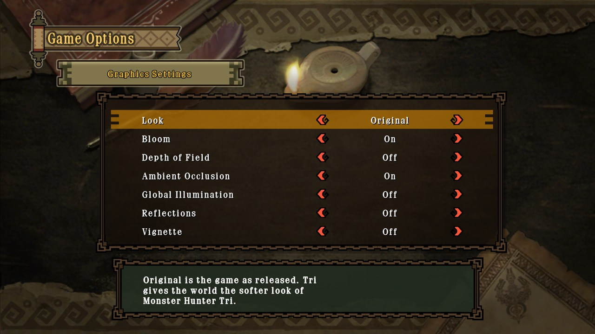
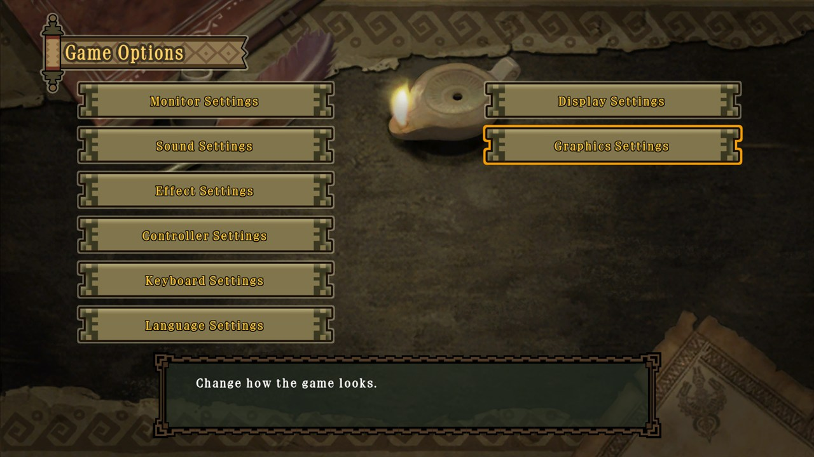
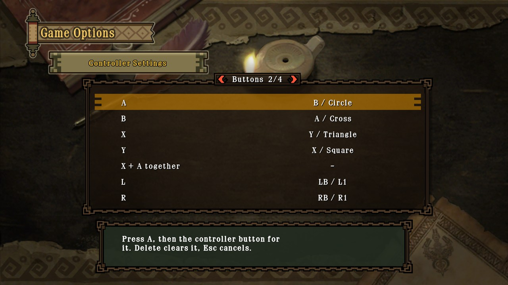
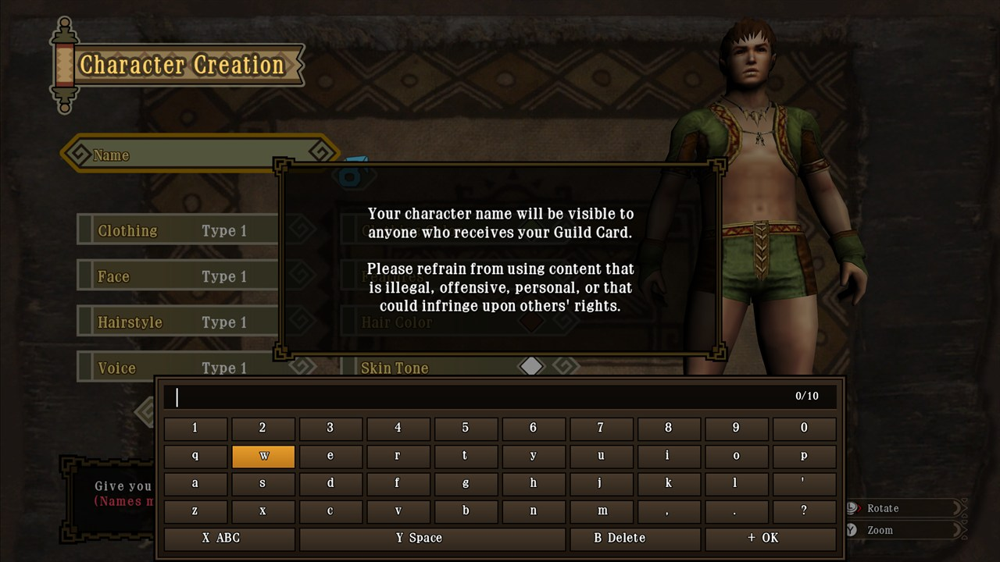
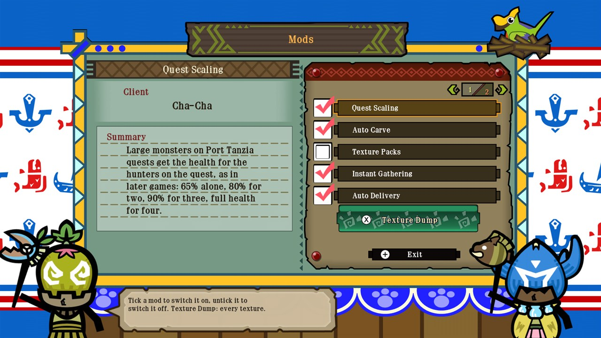

  

**Cha-Cha now lives inside the game.** The launcher is gone: Cha-Cha starts as Monster Hunter 3 Ultimate, and every
setting, mod and add-on sits in the game's own menus, drawn with its own frames and played with its own sounds. This
release also brings a new camera, five gameplay mods you can switch on and off, the DLC screen back as a working
add-on menu, fixes from your reports, and a first experimental Android build.

> [!IMPORTANT]
> **Coming from 0.1.x?** Read [Upgrading](#upgrading-from-01x) below: settings moved into the game, and DLC quests
> now come in through the DLC screen instead of installing themselves at start.

## Everything in the game's own menus

| | |
|---|---|
| **Game Options** (title screen) | A second column next to the game's own: **Display Settings** and **Graphics Settings**. **Controller Settings** opens Cha-Cha's button remapping, and **Keyboard Settings** takes the place of the old Game Settings page for keys and mouse. |
| **Pause menu: new CFG tab** | Display, Graphics and **Camera Settings** and **Mods**, changed and saved on the spot, in town and on quests. |
| **Main menu: DLC** | Official DLC, your custom quests and the mods list (see below). The connection notices before it are skipped. |

Every page works with a controller (L / R turn pages), the keyboard, and the mouse: hover selects, a click chooses
or changes a value. The pages show what each setting does and when it takes effect.

  
  

- **An on-screen keyboard in the game's style** wherever the game asks for text: d-pad, face buttons, hover and
  click; the PC keyboard still types.

  
- **A loading screen** while the game's shaders are translated on first start: "Compiling shaders...", a bar and a
  percentage.
- **The mouse in more menus:** hover now jumps straight to the row under the pointer instead of walking through every
  row in between (main menu, Character Select and the rest of the game's menus).

## Camera

- **Modern Camera** (CFG → Camera Settings, off by default): on quests the camera orbits freely. The mouse moves it
  directly, the stick turns and tilts at once, and it drifts gently back behind you as you run. L works as before.
- **Camera Distance** (#17): from the game's own distance up to 200 %, on quests and in free roam, so big monsters
  stay on screen. Towns keep their own camera.

## Mods you can switch

Every mod is in **DLC → Mods** and in the pause menu's **CFG → Mods**, ticked on or off and saved at once.

| Mod | What it does | Default |
|---|---|---|
| **Quest Scaling** (#1) | Monster HP on Port Tanzia quests follows the number of hunters: 65 % alone, 80 % for two, 90 % for three, full for four. | On |
| **Auto Carve** | Hold the gather button to keep carving, gathering and mining until the spot is used up. | On |
| **Texture Packs** | Your replacement textures from `texture_replacements`. | On |
| **Instant Gathering** | One gather, mine or bug-net swing takes everything a spot has left; each item still rolls its reward and tool breakage. | Off |
| **Auto Delivery** | Delivery goals are handed in as soon as your pouch holds enough (eggs and other carried items still go to camp). | Off |
| **Key Quest Markers** | A star on key and urgent quests in the quest lists: gold while you need them, grey once cleared. | Off |

  

## The DLC screen works again

Capcom's download service is long gone, so Cha-Cha now answers the game's DLC screen itself, locally; nothing goes
online. It has three sections:

- **Official**: the game's own DLC menus with Capcom's event and challenge quests, from `<data folder>/bonus`.
- **Quests**: your custom quests, from `<data folder>/custom`.
- **Mods**: the list above, plus **Texture Dump** on X.

Pick quests, choose Download, and they land at the Port Tanzia Gathering Hall. Each quest's page shows its level,
locale, time limit, reward, fee and target monsters, read from the quest file. Quest numbers and folders:
[docs/mods.md](https://github.com/BoyClinton/Cha-Cha/blob/main/docs/mods.md).

**Texture Dump** writes every texture in the game (not only what you have seen) to `texture_dump`, already named for
texture packs, with the game's download bar showing how far it is. Cancel stops it.

## Fixed

- **Water and terrain showing through each other in the distance** (#15): the sea and hidden water were pulled
  forward over low rocks and banks far away.
- **Effects too fast above 30 FPS** (#15): dust, sparks and other particles lived and moved up to 3× too fast at
  high frame rates; they now run at the game's own pace at any frame rate.
- **Linux tarball on FFmpeg 8 / 9 distributions** (#16, CachyOS, Arch): the tarball now carries its own FFmpeg and
  SDL3 in `lib/`, so your distribution's FFmpeg version no longer matters.
- Fog lookups in some shaders could read past their table.

## Android (experimental)

A first **arm64 APK** for Android 10 and newer with Vulkan 1.1 (#18). It is the same game code as the PC builds,
compiled for ARM. **It has not been run on a device yet**, so expect it not to start on some phones; reports with
the `log.txt` are very welcome on #18.

- **Controls:** a controller is needed: a handheld's built-in controls (Odin, Retroid, Ayaneo...), a Bluetooth or
  USB controller, or a clip-on one. There are no touch controls yet.
- **Your dump:** connect the device to a PC over USB and copy it into a folder named `game` in
  `Android/data/io.github.boyclinton.chacha/files`. `log.txt` lands in the same folder.
- Debug-signed for testing: Android will ask to allow installing it.

## Upgrading from 0.1.x

- **Replace the program files** and keep your data folder (`%APPDATA%\Cha-Cha`, `~/.local/share/Cha-Cha`, or `data\`
  of a portable install): saves, settings, key bindings and texture packs carry over.
- **No launcher any more.** What was in its Settings window is now in Game Options and the pause menu's CFG tab. F3
  (GamePad screen) and F11 (fullscreen / window) work as before.
- **DLC quests** no longer install themselves when the game starts. Quests in the old `quests` folder still show up:
  open DLC → Official (or Quests), tick them and choose Download.
- **HP scaling and hold-to-gather** are now the Quest Scaling and Auto Carve mods, on by default as before.

## Not fixed yet

- The red markers above characters still move too fast above 30 FPS (#7).
- Underwater god rays and the roar dimming under water (#15).
- The Fishmongress and Argosy menus follow the mouse now, but are not tested on a save that has them open (#14).

## Downloads

| | |
|---|---|
| **Windows** 10 / 11 x64 | `Cha-Cha-0.2.0-windows-x64.zip`: extract anywhere you can write to, run `Cha-Cha.exe` |
| **Linux** x86-64 (glibc 2.35+) | `Cha-Cha-0.2.0-x86_64.AppImage`: `chmod +x`, then run it. Or `Cha-Cha-0.2.0-linux-x86_64.tar.gz`: extract, run `./Cha-Cha` |
| **Android** 10+, arm64 (experimental) | `Cha-Cha-0.2.0-android-arm64.apk` |

Graphics: Vulkan 1.2 on PC, 1.1 on Android. You need your own dump of Monster Hunter 3 Ultimate (US) with update
v32; see the [README](https://github.com/BoyClinton/Cha-Cha#getting-started).
